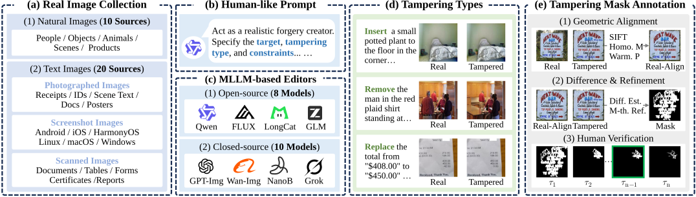

# MLLM-Edit
Official implementation of MLLM-Edit from our NeurIPS 2026 paper “MLLM-Edit: Benchmarking Image Forgery Detection and Localization under MLLM-based Editing”. <br>
[](https://huggingface.co/datasets/Zegkim/MLLM-Edit) [](https://github.com/ZeqinYu/MLLM-Edit) []()  
Zeqin Yu, Ye Tian, Jian Zhang, Jiangqun Ni, Lanyun Zhu, Alex Kot, Xudong Jiang  

## Overview



MLLM-Edit is a large-scale benchmark for image forgery detection and localization (IFDL) under MLLM-based editing, comprising over 240k tampered images from diverse natural and text image sources. It covers 18 MLLM-based editors (8 open-source and 10 closed-source) and three tampering types: insertion, removal, and replacement.

MLLM-Edit is constructed through three stages: real image–prompt preparation, tampered image generation, and semi-automatic tampering mask annotation.

## Dataset

MLLM-Edit consists of two complementary versions covering natural and text images. 
| Version | Model Source | MLLM-based Editors | Images |
|---|---|---|---:|
| **MLLM-Edit-v1** | Open-source (8) | Qwen-IEPlus, OmniGen-v2, BAGEL, FLUX.2 [klein] Base 9B, Step1X-Edit v1.2, LongCat-Image, GLM-Image, JoyAI-Image-Edit | 20,026 |
| **MLLM-Edit-v1** | Closed-source (10) | HunyuanImage 3.0, Kling Image 3.0, Wan 2.6 Image, Vidu Q2, Seedream 4.5, Jimeng 4.6, GPT Image 2/1.5, Grok Imagine, Reve V1, Nano Banana Pro (Gemini 3 Pro) | 24,260 |
| **MLLM-Edit-v2** | Open-source (5) | Qwen-IEPlus, FLUX.2 [klein] Base 9B, Step1X-Edit v1.2, LongCat-Image, JoyAI-Image-Edit | 197,927 |

In our experiments, MLLM-Edit-v1 is primarily used for evaluation, while MLLM-Edit-v2 provides larger subsets for model training.

Each tampered image is paired with its corresponding original image and editing prompt. Pixel-level tampering masks are provided for samples with valid annotations.

**Download:** 🤗 [Hugging Face](https://huggingface.co/datasets/Zegkim/MLLM-Edit)

**Structure:**

```text
MLLM-Edit/
├── MLLM-Edit-v1/
│   ├── Natural/
│   │   └── {Model}/       # 18 editors: 8 open-source + 10 closed-source
│   │       ├── Real/      # Original images
│   │       ├── Tamper/    # Tampered images
│   │       ├── Mask/      # Corresponding pixel-level binary masks
│   │       └── prompt.csv # Editing prompts
│   └── Text/
│       └── {Model}/       
│           ├── Real/
│           ├── Tamper/
│           ├── Mask/
│           └── prompt.csv
│
└── MLLM-Edit-v2/
    ├── Natural/
    │   └── {Model}/       # 5 open-source editors
    │       ├── Real/
    │       ├── Tamper/
    │       ├── Mask/
    │       └── prompt.csv
    └── Text/
        └── {Model}/       
            ├── Real/
            ├── Tamper/
            ├── Mask/
            └── prompt.csv
```


## Code

We provide the semi-automatic mask annotation pipeline used to construct MLLM-Edit, including candidate mask generation, a human annotation interface, and demonstration samples.

**Available:**  [Mask Annotation Pipeline](./MLLM-Edit_Mask_Annotation_Pipeline)

## Contact

We welcome researchers to use MLLM-Edit and appreciate citations to our paper. If you have any questions or encounter any issues, please feel free to contact us at 📧 [kimjyu@foxmail.com](mailto:kimjyu@foxmail.com).

## ✍️ Citation

If you find MLLM-Edit useful for your research, please consider citing our paper:

```bibtex
@inproceedings{yu2026mllmedit,
  title={MLLM-Edit: Benchmarking Image Forgery Detection and Localization under MLLM-based Editing},
  author={Yu, Zeqin and Tian, Ye and Zhang, Jian and Ni, Jiangqun and Zhu, Lanyun and Kot, Alex and Jiang, Xudong},
  booktitle={The Fortieth Annual Conference on Neural Information Processing Systems},
  year={2026}
}
```
